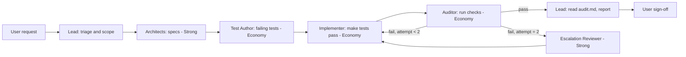

# Multi-Agent Orchestration Protocol

## 1. Purpose

Define how a lead agent coordinates specialist subagents to deliver code changes. The protocol has two goals:

1. **Keep deep reasoning on strong models.** Architecture, risk judgment, and final verification need the best model available.
2. **Push code generation to cheaper models.** Writing code to a precise spec is mechanical when the spec is good. Most token spend should go to implementation, and that work should run on the cheapest model that can pass the tests.

Guiding rule: **think expensively once, type cheaply many times.**

## 2. Failure Modes Addressed

- **Triage bias.** Runtime errors prompted immediate fixes by the lead instead of delegation.
- **Instruction drift.** After context was summarized, the delegation rule became history instead of an active constraint.
- **Context pollution.** Diffs, compiler output, and test logs filled the lead's context, weakening high-level reasoning.
- **Cost leakage.** Strong models were doing mechanical work, and cheap models were given vague specs that caused retry loops.

Written rules alone do not fix these. The mitigations below rely on tool permissions, files, and budgets.

## 3. Model Tiers & Subagent Engines

This protocol is **environment-agnostic** across macOS and Windows. Tasks are partitioned between high-level reasoning and economy code generation:

| Tier | Engine / Role | Used for | Relative cost |
|---|---|---|---|
| **Strong** | **Host AI (e.g., Gemini / Antigravity Lead)** | Lead orchestration, Architects, escalation review, Auditor judgment | High. Use sparingly. |
| **Economy** | **DeepSeek Subagents** (`deepseek-chat` / `deepseek-reasoner`) | Test Authors, Implementers (Coders), mechanical audit runs | Low. Default for all code generation. |

Rule: **a strong model never writes production code on its first pass, and an economy model never makes an architectural decision.** If either happens, the work has been routed wrong.

### 3.1 Subagent Dispatch Mechanism (Cross-Platform)

Subagents are invoked according to available environment tooling:
- **macOS / Linux:** DeepSeek Harness CLI (`dsh headless "<prompt>"` or `node scripts/deepseek-subagent.mjs`), with `DSH_PERMISSION_MODE=danger-full-access`.
- **Windows:** DeepSeek Harness CLI (`dsh.cmd` / PowerShell wrapper or `node scripts/deepseek-subagent.mjs`).
- **Direct API Fallback:** Using `DEEPSEEK_API_KEY` via `https://api.deepseek.com` (supported natively by `scripts/deepseek-subagent.mjs`).

## 4. Roles

| Role | Tier | Engine | Responsibility | Writes | Tool permissions |
|---|---|---|---|---|---|
| **Lead** | Strong | Host AI (Gemini) | Triage, scope, dispatch, verification, user reporting | Handoff index, user updates | Read, dispatch, task tracking. **No write or edit on source paths.** |
| **Architect** (one per domain: engine, media, graphics) | Strong | Host AI (Gemini) | Specs and type contracts | `docs/handoffs/<task>/spec-<domain>.md` | Read-only on source |
| **Test Author** | Economy | DeepSeek Subagent | Failing tests from specs | `tests/**` | Write tests, run tests. Does not read implementation for the target behavior. |
| **Implementer (Coder)** | Economy | DeepSeek Subagent | Minimal code to pass failing tests | Files on the task's allowlist only | Write source, run tests. No test edits. |
| **Auditor (Reviewer)** | Economy runs checks; Strong judges only on escalation | DeepSeek Subagent / Host AI | Run test, typecheck, build; summarize results | `docs/handoffs/<task>/audit.md` | Run tests, typecheck, build. No source edits. |
| **Escalation Reviewer** | Strong | Host AI (Gemini) | Diagnose repeated failures, rule on ambiguous specs | Review note in handoff folder | Read, run tests. No source edits unless it is the only path. |


## 5. Scope Threshold

| Change | Pipeline |
|---|---|
| Single file, no new behavior, no public API change | **Lightweight:** one Implementer with a test, then one Auditor run. |
| Multi-file, new behavior, or cross-domain | **Full pipeline** (Section 6). |
| Anything touching user-visible behavior | **Full pipeline**, regardless of size. |

Skipping the full pipeline requires the lead to state the reason before dispatching. The user can override.

## 6. Workflow



**Phase 0: Specs (Strong).** Architects write specs using the template in Section 7. The lead checks that every acceptance criterion has a planned test.

**Phase 1: Tests (Economy).** The Test Author writes tests from the spec. The lead confirms the tests fail for the expected reason (assertion failure, not an import or syntax error). If they fail for the wrong reason, the spec or test is fixed before any implementation starts.

**Phase 2: Implementation (Economy).** The Implementer works only from: the spec, the failing test output, and the files on its allowlist. It returns a unified diff, not full file contents. It may not modify tests. If a test looks wrong, it stops and reports.

**Phase 3: Audit (Economy).** The Auditor runs the full suite, typecheck, and build, and writes `audit.md`. Pass/fail is decided by the commands' exit codes. The Auditor does not interpret ambiguous results. It flags them for escalation.

**Phase 4: Verification (Strong, light).** The lead reads `audit.md` only, not raw logs. It checks `git status` for unexpected files and reports to the user.

## 7. Spec Template

Specs are the main lever on cost. A precise spec reduces retries. Keep each spec under about 150 lines.

```markdown
# Spec: <feature name>

## Goal
One or two sentences.

## Type contracts
Exact signatures for every new or changed public type and function.

## Behavior
Numbered rules. Each rule is testable.

## Acceptance criteria
- [ ] AC-1: ...  (maps to test: <name>)
- [ ] AC-2: ...

## Allowed files
Explicit list. The Implementer may not touch anything else.

## Out of scope
Explicit list.

## Known risks
Concurrency, memory, performance, security, or "none identified".
```

The **Allowed files** list is the most important field for cost control. It stops the Implementer from reading and rewriting the whole repo.

## 8. Cost Controls

### 8.1 Context budgets
- **Lead:** reads specs, `audit.md`, and `git status`. It does not read raw test logs, diffs, or source files unless it is reviewing a risky change.
- **Implementer:** gets the spec, failing test output (truncated to the first failure with its stack), and allowlisted files only.
- **Test Author:** gets the spec and existing test conventions. It does not get implementation source for the target behavior.

### 8.2 Diff-only output
Economy agents return unified diffs for changes to existing files. Full file content is allowed only for new files. This cuts output tokens, which are usually the most expensive part.

### 8.3 Scripted checks, not model checks
Test, typecheck, lint, and build runs are shell commands. The Auditor should run them as a script that prints a short summary, such as:

```
test:      PASS  (1145/1145)
typecheck: PASS
build:     PASS
memory:    PASS  (no new listeners detected)
```

The model reads the summary, not the raw output. Raw logs go to a file in the handoff folder and are opened only on failure.

### 8.4 Retry budget
- An Implementer gets **2 attempts** per failing test set.
- Each retry includes only the new failure output and the previous diff. It does not repeat the full history.
- After 2 failed attempts, the task escalates (Section 9). It does not get a third economy attempt.

### 8.5 Caching stable context
Type contracts, the spec template, coding conventions, and the allowlist pattern live in files that agents read by reference. They are not pasted into every prompt. Prompt caching should be enabled where the platform supports it, with stable content placed before variable content.

### 8.6 Batching
Independent tasks are dispatched together in one message so they run in parallel. Tasks that touch the same files run sequentially.

### 8.7 Pipeline bypass for trivial changes
Use the lightweight pipeline (Section 5) when the change qualifies. Running six agents on a one-line fix costs more than the fix is worth.

## 9. Escalation to Strong Models

Escalate to the Escalation Reviewer when any of these is true:

- Two economy attempts have failed on the same test set.
- The change touches a public type, a shared interface, or a schema.
- The change involves concurrency, memory lifetime, performance-critical paths, or security.
- The Implementer reports that the spec is ambiguous or contradictory.
- The Auditor flags a result it cannot classify as pass or fail.

The Escalation Reviewer receives: the spec, the last diff, the last failure summary, and the Implementer's stated blocker. It does not receive the full attempt history. Its output is one of: a corrected spec, a specific fix instruction for an economy agent, or a decision to stop and ask the user.

## 10. Guardrails

1. **Tool permissions enforce roles.** The lead has no write access to source paths and delegates implementation, testing, and mechanical auditing to DeepSeek subagents (via `dsh` or `scripts/deepseek-subagent.mjs`). Each subagent can write only within its scope (Section 4).
2. **Rules live in a persistent file.** This document's rules are copied into the project's standing instruction file (for example `AGENTS.md`), which loads every session and is not subject to summarization.
3. **Handoffs are files.** Agents communicate through `docs/handoffs/<task>/`. Summaries in chat are not a handoff.
4. **Pre-edit checklist.** Before any source change, the lead records in the handoff index: the phase, the owning agent, the scope tier (Section 5), and the attempt count.
5. **Escalate, don't improvise.** A blocked subagent reports to the lead. The lead re-dispatches, escalates per Section 9, or asks the user. It does not fix the blocker itself.
6. **Stop conditions.** If a task exceeds 3 escalations or the user's stated budget, the lead stops and reports rather than continuing.

## 11. Exit Criteria

A task is complete when:

- `audit.md` shows all checks passing.
- Test count is the same or higher. No tests were deleted or skipped without a written reason in `audit.md`.
- `git status` shows only files on the allowlist.
- The lead has reported the audit summary to the user.

## 12. Metrics to Track

Record these per task in `docs/handoffs/<task>/metrics.md`. Use them to tune the protocol.

| Metric | Why it matters |
|---|---|
| Economy attempts per task | High values mean specs are too vague. |
| Escalation rate | High values mean economy routing is wrong for that task type. |
| Strong-model tokens per task | Should stay small relative to economy tokens. |
| Output tokens per task (by tier) | Output is the most expensive token type. |
| Lightweight vs. full pipeline ratio | Confirms the threshold is applied. |
| Guardrail violations | Any direct source edit by the lead counts as a violation. |

If strong-model spend rises while escalation rate stays flat, the lead is doing work that should be delegated. If economy attempts rise, the specs need work.
