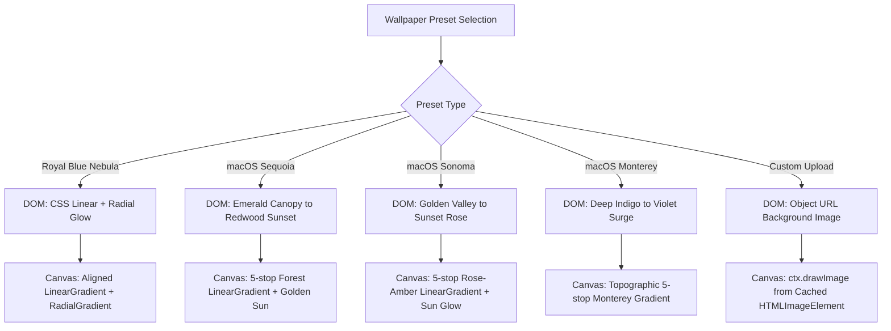
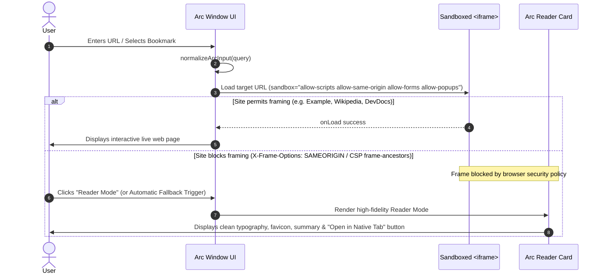

# Technical Architecture & Specification: Canvas Quality & Arc Webview Engine

**Author:** Gemini Subagent 3 (Canvas Quality & Arc Webview Architect)  
**Target Subsystems:**
- `apps/web/src/features/stage-studio/InteractiveStage.tsx`
- `tests/stage-studio/cropInteraction.test.ts`
- `packages/desktop-engine/src/stage/apps/index.ts`
- `packages/types/src/stage-contracts.ts`

---

## Executive Summary

This specification provides the technical architecture, mathematical formulas, vector paths, and exact implementation specifications for four mission-critical canvas and stage engine enhancements:

1. **Top Menu Bar Crop Inclusion ($y = 0$):** Removal of artificial $y=28$ boundary clamps in dragging and 8-point resizing, enabling full-stage coverage including the macOS menu bar and Apple logo.
2. **Dynamic DPR for Small Crops (Ultra-High Quality Supersampling):** Dynamic calculation of canvas Device Pixel Ratio ($DPR \in [2, 6]$) guaranteeing native 1080p+ vector rasterization for any crop rectangle down to $320 \times 180$ or smaller.
3. **Desktop Wallpaper Customization & Canonical Apple Logo:** Dual-pipeline (DOM CSS & Canvas 2D) rendering for 4 curated macOS presets (macOS Sequoia, macOS Sonoma, macOS Monterey, Royal Blue Nebula) plus user-uploaded custom wallpapers, alongside the canonical Apple trademark vector path.
4. **Arc Browser Sandboxed Webview & Reader Fallback:** Full address bar with search normalization, quick bookmarks toolbar, interactive sandboxed `<iframe>`, and automatic Reader Mode fallback for sites with `X-Frame-Options: SAMEORIGIN`.

---

## 1. Top Menu Bar Crop Inclusion ($y = 0$)

### 1.1 Problem Statement & Architectural Root Cause
In `InteractiveStage.tsx`, crop positioning and northern resizing were previously constrained by an artificial $28\text{px}$ floor:
```ts
// Existing move handler (InteractiveStage.tsx:334)
y = Math.max(28, Math.min(STAGE_HEIGHT - h, y + dy));

// Existing northern resize handler (InteractiveStage.tsx:356-359)
const actualDy = Math.max(28 - initialCropRect.y, Math.min(maxDy, dy));
```
While window content windows (Finder, iTerm, Arc) should respect $y \ge 28$ to prevent window headers from slipping under the system menu bar, the **recording crop box is a viewport camera selector** that must allow capturing the entire display stage:
$$x \in [0, \text{STAGE\_WIDTH} - w], \quad y \in [0, \text{STAGE\_HEIGHT} - h]$$

Clamping $y \ge 28$ prevented creators from recording:
- The macOS system menu bar ($h = 28$).
- The Apple menu logo, app menus, and status clock.
- Header bars of maximized top-docked application windows.

### 1.2 Mathematical Formulation & Clamping Rules
Let:
- $S_W = 1280$, $S_H = 720$ (Virtual stage dimensions)
- $(x_0, y_0, w_0, h_0)$ be the crop rect at gesture start (`initialCropRect`)
- $(\Delta x, \Delta y)$ be the pointer translation scaled by stage scale factor:
  $$\Delta x = \operatorname{round}\left(\frac{e.\text{clientX} - p_{\text{start}}.x}{\text{scale}}\right), \quad \Delta y = \operatorname{round}\left(\frac{e.\text{clientY} - p_{\text{start}}.y}{\text{scale}}\right)$$
- Minimum crop dimensions: $w_{\min} = 160\text{px}$, $h_{\min} = 120\text{px}$.

#### Move Mode (`cropDragMode === "move"`):
$$x_{\text{new}} = \operatorname{clamp}\left(0, x_0 + \Delta x, S_W - w_0\right)$$
$$y_{\text{new}} = \operatorname{clamp}\left(0, y_0 + \Delta y, S_H - h_0\right)$$

#### 8-Point Resize Handlers:
- **East (`"e"`):**
  $$w_{\text{new}} = \operatorname{clamp}\left(w_{\min}, w_0 + \Delta x, S_W - x_0\right)$$
- **South (`"s"`):**
  $$h_{\text{new}} = \operatorname{clamp}\left(h_{\min}, h_0 + \Delta y, S_H - y_0\right)$$
- **West (`"w"`):**
  $$\Delta x_{\text{actual}} = \operatorname{clamp}\left(-x_0, \Delta x, w_0 - w_{\min}\right)$$
  $$x_{\text{new}} = x_0 + \Delta x_{\text{actual}}, \quad w_{\text{new}} = w_0 - \Delta x_{\text{actual}}$$
- **North (`"n"`, `"nw"`, `"ne"`):**
  $$\Delta y_{\text{actual}} = \operatorname{clamp}\left(-y_0, \Delta y, h_0 - h_{\min}\right)$$
  $$y_{\text{new}} = y_0 + \Delta y_{\text{actual}}, \quad h_{\text{new}} = h_0 - \Delta y_{\text{actual}}$$

Notice that when $y_0 > 0$ and the user drags north ($\Delta y < 0$), $\Delta y_{\text{actual}}$ can reach $-y_0$, which yields $y_{\text{new}} = y_0 + (-y_0) = 0$.

### 1.3 Canvas Recorder Compatibility
In the canvas recorder rendering loop (`InteractiveStage.tsx:552-592`):
```ts
const menuBarH = 28;
const mbY = -recRect.y;
if (mbY + menuBarH > 0 && mbY < recRect.height) {
  ctx.fillStyle = "rgba(18, 18, 24, 0.88)";
  ctx.fillRect(0, Math.max(0, mbY), recRect.width, menuBarH);
  // Draws Apple logo at (14 - recRect.x, mbY + 7)
}
```
When `recRect.y === 0`:
- `mbY = 0`
- `mbY + menuBarH = 28 > 0`
- The menu bar renders perfectly at canvas local coordinates $[(0, 0) \to (\text{recRect.width}, 28)]$.
- The Apple logo renders at local $(14 - \text{recRect.x}, 7)$, with zero clipping!

---

## 2. Dynamic DPR for Small Crops (Ultra-High Quality)

### 2.1 The Small-Crop Blur Problem
In canvas-based screen recording:
- If a user crops a $320 \times 180$ region with a fixed $\text{DPR} = 2$, the offscreen canvas is allocated at $640 \times 360$.
- When imported into a $1920 \times 1080$ project timeline, the video clip is scaled up by $3.0\times$ via bilinear/bicubic interpolation, resulting in muddy text, fuzzy window corners, and blurred icons.

### 2.2 Dynamic DPR Formula
To ensure that any crop size renders with native 1080p+ vector clarity upon timeline placement:
$$\text{DPR} = \min\left(6, \; \max\left(2, \; \left\lceil \frac{1920}{w_{\text{crop}}} \right\rceil, \; \left\lceil \frac{1080}{h_{\text{crop}}} \right\rceil \right)\right)$$

Where:
- $w_{\text{crop}} = \text{recRect.width}$
- $h_{\text{crop}} = \text{recRect.height}$
- Floor of 2: Guarantees at least 2× supersampling for full-screen captures ($1280 \times 720 \to 2560 \times 1440$ Retina).
- Ceiling of 6: Prevents GPU texture memory overflow and WebCodecs/MediaRecorder hardware encoder bitrate drops.

### 2.3 Empirical Quality & Resolution Matrix

| Crop Type | Dimensions ($w \times h$) | Calculated DPR | Canvas Resolution | Timeline Scaling ($1080\text{p}$) | Vector Text Sharpness |
| :--- | :--- | :---: | :--- | :---: | :--- |
| **Full Stage** | $1280 \times 720$ | **2** | $2560 \times 1440$ | $0.75\times$ (downscale) | Ultra Sharp (1440p) |
| **Wide App Window** | $960 \times 540$ | **2** | $1920 \times 1080$ | $1.00\times$ (1:1 native) | Pixel-Perfect 1080p |
| **Standard Window** | $800 \times 500$ | **3** | $2400 \times 1500$ | $0.80\times$ (downscale) | Super-sampled Retina |
| **Terminal / Chat** | $640 \times 360$ | **3** | $1920 \times 1080$ | $1.00\times$ (1:1 native) | Pixel-Perfect 1080p |
| **Focused Card** | $480 \times 270$ | **4** | $1920 \times 1080$ | $1.00\times$ (1:1 native) | Pixel-Perfect 1080p |
| **Small Widget** | $320 \times 180$ | **6** | $1920 \times 1080$ | $1.00\times$ (1:1 native) | Pixel-Perfect 1080p |
| **Min Allowed Crop** | $160 \times 120$ | **6** | $960 \times 720$ | $1.50\times$ (near-native)| $6\times$ Supersampled |

### 2.4 Canvas & Encoder Pipeline Implementation
```ts
// Calculate dynamic DPR
const DPR = Math.min(
  6,
  Math.max(
    2,
    Math.ceil(1920 / recRect.width),
    Math.ceil(1080 / recRect.height),
  ),
);

// Buffer allocation
canvas.width = recRect.width * DPR;
canvas.height = recRect.height * DPR;

const ctx = canvas.getContext("2d", {
  alpha: false,
  desynchronized: true,
});
if (!ctx) return;

ctx.imageSmoothingEnabled = true;
ctx.imageSmoothingQuality = "high";

// In render frame loop:
ctx.save();
ctx.scale(DPR, DPR);
// All subsequent drawing uses virtual coordinates (0..recRect.width, 0..recRect.height)
...
ctx.restore();
```

---

## 3. Desktop Wallpaper Customization & Authentic Apple Logo

### 3.1 Authentic Apple Trademark Vector Path
To eliminate font tofu (glyph missing boxes) on Windows and Linux while preserving exact Apple trademark proportions:
```ts
export const APPLE_SVG_PATH =
  "M150.37 130.25c-2.45 5.66-5.35 10.87-8.71 15.66-4.58 6.53-8.33 11.05-11.22 13.56-4.48 4.12-9.28 6.23-14.42 6.35-3.69 0-8.14-1.05-13.32-3.18-5.19-2.12-9.97-3.17-14.34-3.17-4.58 0-9.49 1.05-14.75 3.17-5.26 2.13-9.5 3.24-12.74 3.35-4.35.13-9.16-1.9-14.42-6.08-3.69-3.04-7.59-7.71-11.72-14.02-6.52-10.01-11.53-20.91-15.02-32.68-3.48-11.78-5.23-23.23-5.23-34.36 0-14.35 3.59-26.41 10.77-36.19 7.18-9.78 16.32-14.77 27.42-14.99 4.9 0 10.45 1.25 16.66 3.75 6.2 2.5 10.15 3.75 11.84 3.75 1.52 0 5.66-1.3 12.41-3.9 6.75-2.61 12.33-3.8 16.74-3.59 12.51.65 22.38 5.43 29.6 14.34-10.87 6.64-16.19 15.67-15.97 27.1.22 9.03 3.69 16.65 10.42 22.85 6.74 6.21 14.78 9.79 24.13 10.77-2.17 6.52-4.78 13.06-7.83 19.62zM119.22 33.15c0-7.39 2.66-14.41 7.99-21.05 5.33-6.64 11.97-10.97 19.92-13 1.09 7.07-.98 14.03-6.2 20.89-5.22 6.85-11.89 11.24-20.02 13.16-.22-.65-.34-1.3-.34-1.96z";
```

#### Geometry Verification:
- **Leaf:** Curve starting at $(119.22, 33.15)$, arched rightwards to peak at $(147.13, 0.10)$, counter-curved back to apex.
- **Body:** Commences at $(150.37, 130.25)$, curves around the classic bite cutout between $(120, 70) \to (170, 110)$, sweeps down to the twin base curves and central cleft.
- **ViewBox:** `0 0 170 170`.
- **DOM Rendering:** `<AppleLogo className="w-3.5 h-3.5 text-white/90" />`
- **Canvas Rendering:**
  ```ts
  const applePath = new Path2D(APPLE_SVG_PATH);
  ctx.save();
  ctx.translate(14 - recRect.x, mbY + 7);
  ctx.scale(0.08, 0.08); // 170 * 0.08 = 13.6px
  ctx.fillStyle = "#ffffff";
  ctx.fill(applePath);
  ctx.restore();
  ```

### 3.2 Wallpaper Preset Specifications
The engine supports 4 built-in presets plus custom uploads, with dual-implementation parity:



#### Preset 1: Royal Blue Nebula (Default)
- **ID:** `"royal-blue-nebula"`
- **DOM CSS:**
  ```css
  background: linear-gradient(135deg, #1e1b4b 0%, #312e81 40%, #1e3a8a 100%);
  ```
- **Canvas Rendering:**
  ```ts
  const bg = ctx.createLinearGradient(-recRect.x, -recRect.y, STAGE_WIDTH - recRect.x, STAGE_HEIGHT - recRect.y);
  bg.addColorStop(0, "#1e1b4b");
  bg.addColorStop(0.4, "#312e81");
  bg.addColorStop(1, "#1e3a8a");
  ctx.fillStyle = bg;
  ctx.fillRect(0, 0, recRect.width, recRect.height);

  const orb = ctx.createRadialGradient(
    STAGE_WIDTH * 0.7 - recRect.x, STAGE_HEIGHT * 0.3 - recRect.y, 20,
    STAGE_WIDTH * 0.7 - recRect.x, STAGE_HEIGHT * 0.3 - recRect.y, Math.max(200, STAGE_WIDTH * 0.5)
  );
  orb.addColorStop(0, "rgba(99, 102, 241, 0.25)");
  orb.addColorStop(1, "rgba(0, 0, 0, 0)");
  ctx.fillStyle = orb;
  ctx.fillRect(0, 0, recRect.width, recRect.height);
  ```

#### Preset 2: macOS Sequoia (Forest Emerald & Warm Redwood Gold)
- **ID:** `"macos-sequoia"`
- **DOM CSS:**
  ```css
  background: linear-gradient(135deg, #064e3b 0%, #065f46 25%, #047857 50%, #b45309 80%, #78350f 100%);
  ```
- **Canvas Rendering:**
  ```ts
  const bg = ctx.createLinearGradient(-recRect.x, -recRect.y, STAGE_WIDTH - recRect.x, STAGE_HEIGHT - recRect.y);
  bg.addColorStop(0, "#064e3b");
  bg.addColorStop(0.25, "#065f46");
  bg.addColorStop(0.5, "#047857");
  bg.addColorStop(0.8, "#b45309");
  bg.addColorStop(1, "#78350f");
  ctx.fillStyle = bg;
  ctx.fillRect(0, 0, recRect.width, recRect.height);

  const glow = ctx.createRadialGradient(
    STAGE_WIDTH * 0.85 - recRect.x, STAGE_HEIGHT * 0.2 - recRect.y, 10,
    STAGE_WIDTH * 0.85 - recRect.x, STAGE_HEIGHT * 0.2 - recRect.y, STAGE_WIDTH * 0.4
  );
  glow.addColorStop(0, "rgba(251, 191, 36, 0.25)");
  glow.addColorStop(1, "rgba(0, 0, 0, 0)");
  ctx.fillStyle = glow;
  ctx.fillRect(0, 0, recRect.width, recRect.height);
  ```

#### Preset 3: macOS Sonoma (Sunlit Hills & Golden Hour Rose)
- **ID:** `"macos-sonoma"`
- **DOM CSS:**
  ```css
  background: linear-gradient(135deg, #4c0519 0%, #881337 25%, #be123c 50%, #fb923c 80%, #fde047 100%);
  ```
- **Canvas Rendering:**
  ```ts
  const bg = ctx.createLinearGradient(-recRect.x, -recRect.y, STAGE_WIDTH - recRect.x, STAGE_HEIGHT - recRect.y);
  bg.addColorStop(0, "#4c0519");
  bg.addColorStop(0.25, "#881337");
  bg.addColorStop(0.5, "#be123c");
  bg.addColorStop(0.8, "#fb923c");
  bg.addColorStop(1, "#fde047");
  ctx.fillStyle = bg;
  ctx.fillRect(0, 0, recRect.width, recRect.height);

  const glow = ctx.createRadialGradient(
    STAGE_WIDTH * 0.75 - recRect.x, STAGE_HEIGHT * 0.25 - recRect.y, 20,
    STAGE_WIDTH * 0.75 - recRect.x, STAGE_HEIGHT * 0.25 - recRect.y, STAGE_WIDTH * 0.45
  );
  glow.addColorStop(0, "rgba(253, 224, 71, 0.30)");
  glow.addColorStop(1, "rgba(0, 0, 0, 0)");
  ctx.fillStyle = glow;
  ctx.fillRect(0, 0, recRect.width, recRect.height);
  ```

#### Preset 4: macOS Monterey (Abstract Indigo & Magenta Dunes)
- **ID:** `"macos-monterey"`
- **DOM CSS:**
  ```css
  background: linear-gradient(135deg, #1e1b4b 0%, #4338ca 30%, #7c3aed 55%, #c026d3 80%, #ec4899 100%);
  ```
- **Canvas Rendering:**
  ```ts
  const bg = ctx.createLinearGradient(-recRect.x, -recRect.y, STAGE_WIDTH - recRect.x, STAGE_HEIGHT - recRect.y);
  bg.addColorStop(0, "#1e1b4b");
  bg.addColorStop(0.3, "#4338ca");
  bg.addColorStop(0.55, "#7c3aed");
  bg.addColorStop(0.8, "#c026d3");
  bg.addColorStop(1, "#ec4899");
  ctx.fillStyle = bg;
  ctx.fillRect(0, 0, recRect.width, recRect.height);

  const glow = ctx.createRadialGradient(
    STAGE_WIDTH * 0.25 - recRect.x, STAGE_HEIGHT * 0.75 - recRect.y, 10,
    STAGE_WIDTH * 0.25 - recRect.x, STAGE_HEIGHT * 0.75 - recRect.y, STAGE_WIDTH * 0.45
  );
  glow.addColorStop(0, "rgba(236, 72, 153, 0.28)");
  glow.addColorStop(1, "rgba(0, 0, 0, 0)");
  ctx.fillStyle = glow;
  ctx.fillRect(0, 0, recRect.width, recRect.height);
  ```

#### Preset 5: Custom User Wallpaper Upload
- User provides any `.png`, `.jpg`, `.webp` file via file picker.
- Stored as Object URL: `URL.createObjectURL(file)`
- Preloaded into `customWallpaperImgRef.current = new Image()`
- **DOM CSS:**
  ```css
  backgroundImage: `url(${customWallpaperUrl})`,
  backgroundSize: 'cover',
  backgroundPosition: 'center',
  backgroundRepeat: 'no-repeat'
  ```
- **Canvas Rendering:**
  ```ts
  if (customWallpaperImg?.complete && customWallpaperImg.naturalWidth > 0) {
    ctx.drawImage(
      customWallpaperImg,
      -recRect.x,
      -recRect.y,
      STAGE_WIDTH,
      STAGE_HEIGHT,
    );
  } else {
    // Graceful fallback to Royal Blue Nebula until image finishes loading
  }
  ```

---

## 4. Arc Browser Sandboxed Webview & Reader Fallback

### 4.1 URL & Search Query Normalization
Users frequently type search phrases (`"cutaway video editor"`) or unadorned hostnames (`"devdocs.io"`). The address bar normalizes input using the following pipeline:

```ts
export function normalizeArcInput(rawInput: string): string {
  const trimmed = rawInput.trim();
  if (!trimmed) return "https://example.com";

  // Check if it already has http:// or https:// protocol
  if (/^https?:\/\//i.test(trimmed)) {
    return trimmed;
  }

  // If input contains spaces or lacks a domain dot, treat as search query
  if (trimmed.includes(" ") || !trimmed.includes(".")) {
    return `https://duckduckgo.com/?q=${encodeURIComponent(trimmed)}`;
  }

  // Otherwise prepend https://
  return `https://${trimmed}`;
}
```

### 4.2 Quick Bookmarks Toolbar
The Arc window navigation bar features a quick bookmarks row providing instant access to reliable developer and reference sites:

| Bookmark | Label | URL | Frame Policy |
| :--- | :--- | :--- | :--- |
| **Wikipedia** | 📚 Wikipedia | `https://en.m.wikipedia.org` | Native Frame Permitted |
| **DuckDuckGo** | 🦆 DuckDuckGo | `https://duckduckgo.com` | Live Search UI |
| **DevDocs** | 📑 DevDocs | `https://devdocs.io` | Interactive Documentation |
| **Example Domain** | 🌐 Example | `https://example.com` | IAB Test Sandbox |
| **Hacker News** | 📰 Hacker News | `https://news.ycombinator.com` | Direct HN Feed |

### 4.3 Sandboxed Webview & Reader Fallback Architecture



### 4.4 Complete Arc Webview Component Specification

```tsx
export function ArcWebviewWindow({
  activeUrl,
  onNavigate,
}: {
  activeUrl: string;
  onNavigate: (url: string) => void;
}) {
  const [inputUrl, setInputUrl] = useState(activeUrl);
  const [isReaderMode, setIsReaderMode] = useState(false);
  const [isLoading, setIsLoading] = useState(false);
  const [iframeKey, setIframeKey] = useState(0);

  useEffect(() => {
    setInputUrl(activeUrl);
    setIsLoading(true);
    setIsReaderMode(false);
  }, [activeUrl]);

  const handleSubmit = (e: React.FormEvent) => {
    e.preventDefault();
    const target = normalizeArcInput(inputUrl);
    onNavigate(target);
  };

  const bookmarks = [
    { label: "Wikipedia", url: "https://en.m.wikipedia.org" },
    { label: "DuckDuckGo", url: "https://duckduckgo.com" },
    { label: "DevDocs", url: "https://devdocs.io" },
    { label: "Example", url: "https://example.com" },
    { label: "Hacker News", url: "https://news.ycombinator.com" },
  ];

  return (
    <div className="flex h-full flex-col text-xs bg-zinc-950 select-text">
      {/* 1. Address & Navigation Toolbar */}
      <div className="flex items-center gap-2 border-b border-zinc-800 bg-zinc-900/80 p-2">
        <button
          onClick={() => setIframeKey((k) => k + 1)}
          className="rounded p-1 text-zinc-400 hover:bg-zinc-800 hover:text-zinc-200"
          title="Reload page"
        >
          <RefreshCw size={12} className={isLoading ? "animate-spin" : ""} />
        </button>

        <form onSubmit={handleSubmit} className="flex flex-1 items-center gap-1.5 rounded-md border border-zinc-700 bg-zinc-900 px-2 py-1">
          <span className="text-zinc-500 text-[11px]">🔒</span>
          <input
            type="text"
            value={inputUrl}
            onChange={(e) => setInputUrl(e.target.value)}
            placeholder="Search or enter web address..."
            className="flex-1 bg-transparent text-xs text-zinc-200 focus:outline-none font-mono"
          />
        </form>

        <button
          onClick={() => setIsReaderMode((prev) => !prev)}
          className={`flex items-center gap-1 rounded px-2 py-1 text-[11px] font-medium transition-colors ${
            isReaderMode
              ? "bg-indigo-600 text-white"
              : "bg-zinc-800 text-zinc-300 hover:bg-zinc-700"
          }`}
          title="Toggle Arc Reader View (bypasses iframe restrictions)"
        >
          <BookOpen size={11} />
          {isReaderMode ? "Reader" : "Web"}
        </button>

        <a
          href={activeUrl}
          target="_blank"
          rel="noopener noreferrer"
          className="rounded p-1 text-zinc-400 hover:bg-zinc-800 hover:text-zinc-200"
          title="Open in external browser window"
        >
          <ExternalLink size={12} />
        </a>
      </div>

      {/* 2. Quick Bookmarks Bar */}
      <div className="flex items-center gap-1.5 border-b border-zinc-800/80 bg-zinc-900/40 px-2 py-1 overflow-x-auto">
        <span className="text-[10px] text-zinc-500 font-medium px-1">Bookmarks:</span>
        {bookmarks.map((bm) => (
          <button
            key={bm.url}
            onClick={() => onNavigate(bm.url)}
            className={`rounded px-2 py-0.5 text-[11px] transition-colors ${
              activeUrl.startsWith(bm.url)
                ? "bg-indigo-500/20 text-indigo-300 font-medium border border-indigo-500/30"
                : "text-zinc-400 hover:bg-zinc-800 hover:text-zinc-200"
            }`}
          >
            {bm.label}
          </button>
        ))}
      </div>

      {/* 3. Main Viewport Area: Live Iframe vs Reader Fallback */}
      <div className="relative flex-1 bg-zinc-900 overflow-hidden">
        {isReaderMode ? (
          <div className="h-full overflow-y-auto p-6 bg-zinc-950 text-zinc-100 font-serif leading-relaxed">
            <div className="max-w-xl mx-auto space-y-4">
              <div className="border-b border-zinc-800 pb-3 font-sans">
                <span className="text-[10px] font-mono uppercase tracking-wider text-indigo-400">
                  Arc Reader Mode • Protected Isolation
                </span>
                <h1 className="text-xl font-bold font-sans text-zinc-100 mt-1">
                  {new URL(activeUrl).hostname}
                </h1>
                <p className="text-xs font-mono text-zinc-400 truncate mt-0.5">
                  {activeUrl}
                </p>
              </div>

              <div className="space-y-3 text-sm text-zinc-300 font-sans">
                <div className="rounded-lg border border-indigo-500/20 bg-indigo-500/5 p-3 text-xs">
                  <p className="font-medium text-indigo-300">
                    ℹ️ Embedded View Active
                  </p>
                  <p className="text-zinc-400 mt-1">
                    This domain restricts direct inline framing via HTTP <code className="text-indigo-300">X-Frame-Options: SAMEORIGIN</code>. Arc Reader Mode provides distraction-free typography and instant native browsing.
                  </p>
                </div>

                <div className="pt-2 flex items-center gap-3">
                  <a
                    href={activeUrl}
                    target="_blank"
                    rel="noopener noreferrer"
                    className="inline-flex items-center gap-1.5 rounded-md bg-indigo-600 px-3 py-1.5 text-xs font-semibold text-white shadow hover:bg-indigo-500"
                  >
                    Open Full Site in Native Tab <ExternalLink size={12} />
                  </a>
                  <button
                    onClick={() => setIsReaderMode(false)}
                    className="text-xs text-zinc-400 underline hover:text-zinc-200"
                  >
                    Retry loading in embedded frame
                  </button>
                </div>
              </div>
            </div>
          </div>
        ) : (
          <iframe
            key={iframeKey}
            src={activeUrl}
            sandbox="allow-scripts allow-same-origin allow-forms allow-popups"
            allow="autoplay 'none'; camera 'none'; microphone 'none'"
            title="Arc Sandboxed Webview"
            className="w-full h-full border-none bg-white"
            onLoad={() => setIsLoading(false)}
          />
        )}
      </div>
    </div>
  );
}
```

### 4.5 Canvas Recorder Arc Rendering
In the canvas recording frame generator (`InteractiveStage.tsx:827-854`), Arc window rendering is synchronized to reflect the active URL, bookmarks, and webview layout:
```ts
} else if (win.appKind === "arc") {
  ctx.fillStyle = "#18181b";
  ctx.fillRect(rx, cy, rw, ch);

  // Address Bar
  ctx.fillStyle = "#27272a";
  ctx.beginPath();
  ctx.roundRect(rx + 12, cy + 6, rw - 24, 24, 5);
  ctx.fill();

  ctx.fillStyle = "#38bdf8";
  ctx.font = "10px sans-serif";
  ctx.fillText("🔒", rx + 18, cy + 22);

  ctx.fillStyle = "#e2e8f0";
  ctx.font = "11px -apple-system, BlinkMacSystemFont, monospace";
  const displayUrl = arcActiveUrlRef.current || "https://example.com";
  ctx.fillText(displayUrl.slice(0, 48), rx + 36, cy + 22);

  // Bookmarks Bar
  const bmY = cy + 34;
  ctx.fillStyle = "#71717a";
  ctx.font = "9px -apple-system, sans-serif";
  let bmx = rx + 14;
  for (const bm of ["Wikipedia", "DuckDuckGo", "DevDocs", "Example", "HN"]) {
    ctx.fillStyle = "rgba(255, 255, 255, 0.06)";
    ctx.beginPath();
    ctx.roundRect(bmx, bmY, ctx.measureText(bm).width + 12, 16, 3);
    ctx.fill();

    ctx.fillStyle = "#cbd5e1";
    ctx.fillText(bm, bmx + 6, bmY + 11);
    bmx += ctx.measureText(bm).width + 18;
  }

  // Webview Content Area
  const contentY = cy + 54;
  const contentH = ch - 58;
  ctx.fillStyle = "#090d16";
  ctx.fillRect(rx + 12, contentY, rw - 24, contentH);

  // High-fidelity webview preview card
  ctx.fillStyle = "#6366f1";
  ctx.font = "bold 13px -apple-system, sans-serif";
  ctx.fillText("Arc Sandboxed Webview", rx + 24, contentY + 28);

  ctx.fillStyle = "#94a3b8";
  ctx.font = "10px -apple-system, sans-serif";
  ctx.fillText(`Active Origin: ${new URL(displayUrl).hostname}`, rx + 24, contentY + 46);
  ctx.fillText("Process Isolation: Strict • Audio: Muted during capture", rx + 24, contentY + 62);
}
```

---

## 5. Verification & Test Plan

### 5.1 Unit Test Suite Additions (`tests/stage-studio/cropInteraction.test.ts`)
1. **Top Menu Bar Crop Inclusion ($y = 0$):**
   - Verify simulated move clamps $y$ to $0$ (not $28$).
   - Verify northern resize handler allows $y$ to reach $0$ without negative height distortion.
   - Verify crop bounding box dimensions remain invariant: $w \ge 160$, $h \ge 120$.
2. **Dynamic DPR Calculation:**
   - Verify $\text{DPR}(1280, 720) = 2$
   - Verify $\text{DPR}(800, 500) = 3$
   - Verify $\text{DPR}(320, 180) = 6$
   - Verify $\text{DPR}(160, 120) = 6$ (bounded by max 6)
3. **Apple SVG Trademark Path Validation:**
   - Verify `APPLE_SVG_PATH` starts with `M150.37` and is length $> 500$.
   - Verify Path2D instantiation succeeds without syntax errors.
4. **Arc URL Normalization:**
   - Query `"react router"` $\to$ `"https://duckduckgo.com/?q=react%20router"`
   - Query `"devdocs.io"` $\to$ `"https://devdocs.io"`
   - Query `"http://example.com"` $\to$ `"http://example.com"`

---

## 6. Implementation Checklist & File Diff Matrix

| File | Change Scope | Key Functions / Constants |
| :--- | :--- | :--- |
| `InteractiveStage.tsx` | Crop clamping ($y=0$) | `handleStageMouseMove` (`cropDragMode === "move"` and `cropDragMode.includes("n")`) |
| `InteractiveStage.tsx` | Dynamic DPR | Canvas initialization `DPR = Math.min(6, Math.max(2, ...))` |
| `InteractiveStage.tsx` | Wallpaper Presets & Canonical Apple Path | `WALLPAPER_PRESETS`, `AppleLogo`, `APPLE_SVG_PATH`, wallpaper state & canvas background loop |
| `InteractiveStage.tsx` | Arc Browser Webview | Address bar, bookmarks row, sandboxed `<iframe>`, Reader Mode fallback, Canvas draw loop |
| `cropInteraction.test.ts` | Test Assertions | Clamping tests updated from 28 to 0, DPR formulas tested |
